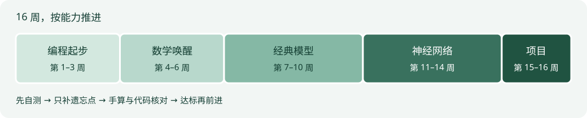

# 数学唤醒，编程起步

> 土木工程 → 机器学习与深度学习 · 16 周 · 每周 8–10 小时

你已经学过高数、线代和概率论。现在要做的是找回能用的知识，把公式、代码和实际问题接起来。数学安排三周集中复习；Python 从零开始，模型从能手算的小例子开始。

## 今天从这里开始

1. 用 [45 分钟自测](diagnostic.md) 定位数学遗忘点。现在还不会编程，不影响数学判断。
2. 看 [前置知识清单](checklist.md)，区分复习、重点补充和选学。
3. 按 [环境准备](setup.md) 运行第一个 Python 程序，再进入 [第 1 周](weeks/01.md)。
4. 复制 [学习记录模板](tracker.md)，只记录亲手完成的内容。

## 一张路线图

手机上可横向滑动路线图查看；下面的表格提供相同信息。

| 阶段 | 时间 | 最后能做什么 |
| --- | --- | --- |
| 编程起步 | 1–3 周 | 读取数据、计算统计量、画图 |
| 数学唤醒 | 4–6 周 | 检查维度、推导梯度、理解似然 |
| 经典模型 | 7–10 周 | 从零实现小模型，并正确评价 |
| 神经网络 | 11–14 周 | 理解自动微分，编写训练循环 |
| 综合项目 | 15–16 周 | 提交可复现实验和局限分析 |

完整安排见 [16 周总表](roadmap.md)。每周按约 9 小时规划；数学模块自测达到 80% 且能解释关键步骤，就跳过已掌握讲解，用空出的时间练代码。总周期允许顺延。

## 学着学着卡住了

- 课上不懂贝叶斯、BP 或 PCA：查 [课程衔接索引](bridge.md)，按需回补，不必等到对应周次。
- 想知道每个资源读哪部分：查 [精选资源](resources.md)。一份主资源已经足够开始。
- 想复习公式：查 [数学唤醒手册](math-refresh.md)。
- 想跑代码：查 [环境与实验](setup.md)；参考解单独放在 [答案页](answers.md)。
- 想知道哪些工作确实验收过：查 [建设与验收](audit.md)。学习计划建设完成不等于学习者已经掌握。

## 使用边界

这是编者为自学组织的路线与自编练习，不是教师官方教材、考试范围或就业承诺。工程场景只帮助建立直觉；合成数据上的结论不能直接用于工程安全判断。现有课程教材保留独立入口：[UCAS 机器学习教材](https://wly63227.github.io/UCAS-machine-learning/)。
